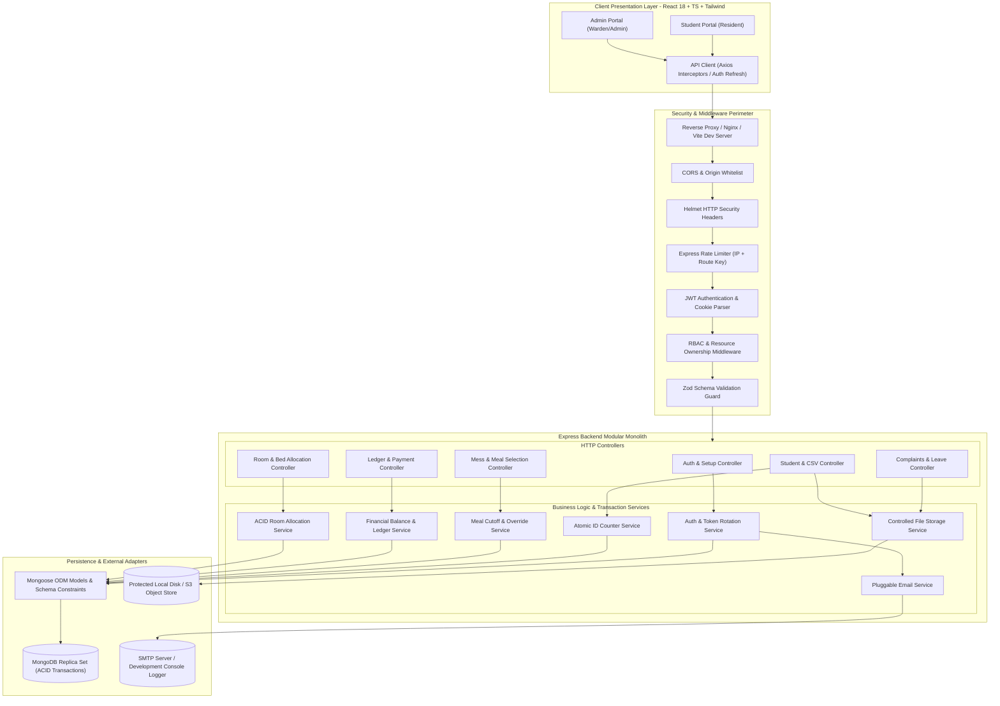
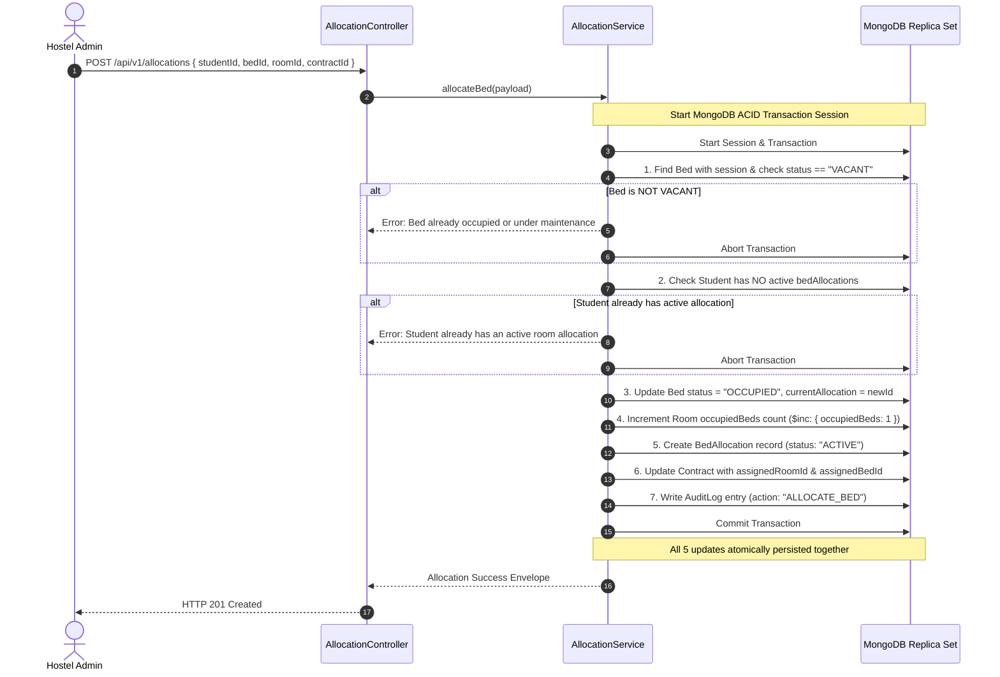
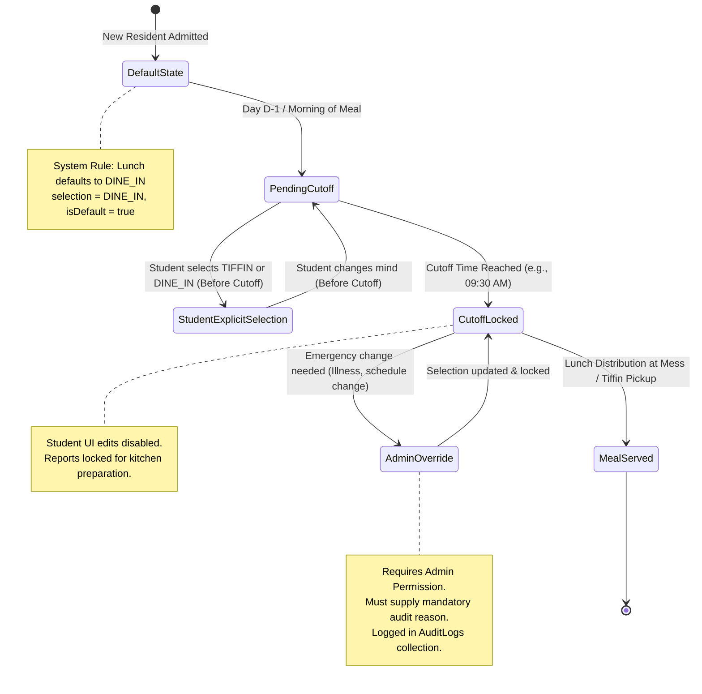

# System Architecture & Technical Design: Smart Hostel & Mess Management System

> **Document Version**: 1.0.0  
> **Status**: Approved for Technical Planning (Phase 1)  
> **Target Audience**: Full-Stack Engineers, Software Architects, Academic Evaluators

---

## 1. High-Level System Architecture

The Smart Hostel & Mess Management System is architected as a **decoupled, modular client-server web application**. It pairs a high-performance **React Single-Page Application (SPA)** with an enterprise-grade **Node.js/Express REST API**, backed by a transactional **MongoDB** document store.



---

## 2. Layered Backend Design Pattern

To maintain clean separation of concerns and maintainability for university grading and enterprise production, the backend follows the **Layered Architecture (N-Tier) Pattern**:

```
[ HTTP Request ]
       │
       ▼
┌───────────────────────────────┐
│ 1. Routing & Middleware Layer  │ ──> CORS, Rate Limiting, JWT Validation, RBAC Guards
└──────────────┬────────────────┘
               │
               ▼
┌───────────────────────────────┐
│ 2. Schema Validation Layer    │ ──> Zod Schema parsing (Strip unknown fields, fail fast)
└──────────────┬────────────────┘
               │
               ▼
┌───────────────────────────────┐
│ 3. Controller Layer           │ ──> Extracts HTTP params/body, invokes services, sets status codes
└──────────────┬────────────────┘
               │
               ▼
┌───────────────────────────────┐
│ 4. Service Layer (Business)   │ ──> Orchestrates business rules, ACID transactions, atomic counters
└──────────────┬────────────────┘
               │
               ▼
┌───────────────────────────────┐
│ 5. Data Access Layer (ODM)    │ ──> Mongoose Schemas, Unique Indexes, Pre/Post Hooks, Query filters
└──────────────┬────────────────┘
               │
               ▼
[ MongoDB Database Engine ]
```

### 2.1 Layer Responsibilities:
1. **Controllers (`src/controllers/`)**: Pure HTTP adapters. They extract data from `req.body`, `req.params`, and `req.query`, invoke the appropriate service method, and format the standardized JSON envelope. No direct database queries are permitted in controllers.
2. **Services (`src/services/`)**: The core domain engine. Contains business rules, multi-document transaction boundaries, audit log generation, and computations (e.g., student balance, meal cutoff checks).
3. **Data Access / Models (`src/models/`)**: Mongoose models defining schema types, validations, default values, and index definitions.
4. **Validation Schemas (`src/validations/`)**: Reusable Zod schemas defining exact input contracts.
5. **Middlewares (`src/middlewares/`)**: Cross-cutting concerns such as authentication, role enforcement, ownership verification, error handling, and file upload parsing.

---

## 3. Critical Architectural Subsystems

### 3.1 Subsystem A: Atomic Sequential Student ID Generation
The requirement demands student IDs formatted as `STU-YYYYMM` followed by an auto-expanding sequence (e.g., `STU-202610001`, expanding to `STU-2026101000` beyond 999), generated on the backend with zero duplicates under concurrent student registrations.

#### Architectural Mechanism:
* We maintain a dedicated `studentIdCounters` collection.
* Each document tracks a specific `yearMonth` key (e.g., `"202610"`).
* When a registration occurs, the service executes MongoDB's atomic `findOneAndUpdate`:

```typescript
// Atomic increment pattern in CounterService with concurrency retry & auto-expanding sequence
const yearMonth = dayjs().format("YYYYMM"); // e.g. "202610"

let counterDoc;
let attempts = 0;
while (attempts < 3) {
  try {
    counterDoc = await StudentIdCounter.findOneAndUpdate(
      { yearMonth: yearMonth },
      { $inc: { seq: 1 } },
      { new: true, upsert: true, setDefaultsOnInsert: true }
    );
    break;
  } catch (err: any) {
    if (err.code === 11000 && attempts < 2) {
      // Upsert race condition on first document of the month: retry
      attempts++;
      continue;
    }
    throw err;
  }
}

// Sequence is strictly monotonically increasing and never rolled back.
// Zero-pad to at least 3 digits; expands naturally beyond 999 (1000, 1001, ...).
const paddedSeq = String(counterDoc.seq).padStart(3, "0");
const generatedStudentId = `STU-${yearMonth}${paddedSeq}`;
// Examples: STU-202610001, STU-202610042, STU-202610999, STU-2026101000
// The issued ID is permanently assigned regardless of downstream workflow outcome.
```

#### Why This Prevents Duplicates:
1. `findOneAndUpdate` is inherently atomic at the document level in MongoDB. Even if 50 requests arrive at the exact same millisecond, MongoDB serializes updates to that single counter document.
2. The `users` collection enforces a **unique partial index** on `{ studentId: 1 }` with `{ partialFilterExpression: { studentId: { $type: "string" } } }`. This guarantees physical database-level uniqueness for all student accounts, while allowing administrator, warden, and staff accounts to exist without student IDs (preventing null-key collisions common to standard sparse indexes).

---

### 3.2 Subsystem B: ACID Multi-Document Transactions for Room Allocation
In a busy hostel onboarding week, multiple administrators might attempt to assign beds simultaneously. Without ACID transactions, two students could be assigned to the exact same bed (a critical race condition).

#### Three-Tier Allocation Defense Architecture:
1. **Tier 1 (Application Pre-Validation)**: Asserts target bed is `VACANT`, target room `occupiedBeds < capacity`, and student has no active allocation.
2. **Tier 2 (ACID Database Transaction)**: Updates bed status to `OCCUPIED`, increments room `occupiedBeds`, inserts `bedAllocations` record, and updates the contract atomically inside `session.withTransaction()`. If concurrent requests target the same bed, MongoDB's write-conflict detection rolls back one transaction cleanly.
3. **Tier 3 (Database Partial Unique Indexes)**:
   * `{ bedId: 1 }, { unique: true, partialFilterExpression: { status: "ACTIVE" } }` on `bedAllocations`: Physically prevents double-booking a bed.
   * `{ studentId: 1 }, { unique: true, partialFilterExpression: { status: "ACTIVE" } }` on `bedAllocations`: Physically prevents a student from holding two active beds.



#### Room-Bed Inventory Invariant:
* The count of physical beds configured for any room must strictly equal its capacity: `count(beds where roomId = room._id) === room.capacity`.
* Room occupancy is strictly bounded: `0 <= room.occupiedBeds <= room.capacity`.

#### Deployment & Environment Requirement:
* MongoDB multi-document transactions require a **Replica Set**.
* **Production & Staging**: MongoDB Atlas clusters automatically run as replica sets.
* **Local Development**:
  * Option 1: Run local MongoDB Community with `--replSet rs0` and execute `rs.initiate()`.
  * Option 2: Provide a one-click `docker-compose.yml` pre-configured with a single-node replica set.
  * Option 3: Backend provides a transaction helper that executes transactions when available, with graceful standalone fallback for offline development.

---

### 3.3 Subsystem C: Financial Ledger Architecture (Double-Entry Inspired)
Financial data integrity is critical. A standard CRUD model where balances are updated directly on the student profile is prone to race conditions, calculation bugs, and audit failures.

#### Ledger Design Principles & Mutability Boundaries:
1. **Separation of Debits and Credits**:
   * Debits (Charges billed to the student) are stored in `chargeRecords`.
   * Credits (Payments made by the student) are stored in `paymentTransactions`.
   * Payouts / Refunds (Security deposit returns) are stored in `refundRecords`.
2. **Strict Append-Only Immutability**:
   * `paymentTransactions` and `refundRecords` are **100% immutable**. Once recorded, they can never be edited or deleted in-place.
   * If an administrator makes a data-entry error (e.g., entered ₹500 instead of ₹5,000) or a cheque bounces, an auditable reversal record (`isReversal: true`, `status: "REVERSED"`, reason) is inserted.
   * Billed amounts on `chargeRecords` (`amount`, `chargeType`, `billingPeriod`, `dueDate`) are immutable. Fees cannot be overwritten; corrections require an administrative Credit Adjustment record or cancelling the charge (`status: "CANCELLED"` with mandatory cancellation reason).
3. **Transactionally Guarded Projections**:
   * `chargeRecords.amountPaid` and `chargeRecords.status` (`UNPAID`, `PARTIALLY_PAID`, `PAID`) are denormalized query projections updated exclusively within multi-document ACID transactions simultaneously with the insertion of `paymentTransactions`.
4. **Backend-Derived Dynamic Balance**:
   * The balance is always computed dynamically on the server:
     $$\text{Outstanding Balance} = \sum_{\substack{\text{charges} \\ \text{status} \neq \text{"CANCELLED"}}} \text{amount} - \sum_{\substack{\text{payments} \\ \text{status} = \text{"SUCCESS"}}} \text{amountPaid} + \sum_{\substack{\text{payments} \\ \text{isReversal} = \text{true}}} \text{amountPaid} + \sum \text{refunds}$$
   * The frontend is never permitted to post an "updated balance" to the server.

---

### 3.4 Subsystem D: Mess Dining Operations & Cutoff State Machine
To minimize the immense food waste caused by unpredicted student dining, the system enforces a strict state machine for daily lunch choices.



#### Distinguishing Explicit vs. Default Selections:
The `mealSelections` collection explicitly maintains:
* `selection`: `"DINE_IN"` | `"TIFFIN"`
* `isDefault`: `true` if generated by system automation; `false` if explicitly chosen by the student.
* This distinction is vital for kitchen analytics: kitchen managers can observe what percentage of residents actively select meals versus passively take the default.

---

### 3.5 Subsystem E: Secure Controlled Storage Abstraction
Students must upload KYC documents (Aadhaar, PAN, College ID) and complaint photos. Storing these directly in an unauthenticated `public/` web server directory creates severe data privacy and compliance violations.

#### Storage Architecture:
* **Storage Interface (`src/services/storage/IStorageService.ts`)**:
  Defines contracts: `saveFile(file, folder)`, `getFileStream(fileKey)`, `deleteFile(fileKey)`.
* **Implementations**:
  * `LocalDiskStorageService`: Saves files to a non-public local directory (`./uploads/private/`), generating a secure random UUID filename (e.g., `8f7b3c2e-4b1a-4d9e-9f3a-1a2b3c4d5e6f.pdf`).
  * `S3StorageService`: Pluggable for production AWS S3 or Cloudflare R2 object storage.
* **Access Control**:
  * Files are never exposed via static URL.
  * Access is mediated through an authenticated API route:  
    `GET /api/v1/profile/documents/:documentId`
  * The route checks that the requesting user is either:
    1. An administrator with `students:view_sensitive` permission.
    2. The individual student who owns the document.
  * If authorized, the server streams the file with appropriate `Content-Type` and `Content-Disposition` headers.

---

### 3.6 Subsystem F: Dual-Token Authentication & Refresh Rotation
* **Access Token**: Short-lived (15 minutes), containing `{ userId, studentId, role, permissions }`. Carried in HTTP `Authorization: Bearer <token>` header.
* **Refresh Token**: Long-lived (7 days), signed with a distinct cryptographic key (`JWT_REFRESH_SECRET`). Carried in an `HttpOnly`, `SameSite=Strict`, `Secure` cookie.
* **Replay & Theft Detection**:
  * The SHA-256 hash of the valid refresh token is stored in the user document.
  * When `/api/v1/auth/refresh` is called, the server validates the signature, hashes the token, and matches it with the database.
  * If matched: a new access token and a new refresh token are generated; the old refresh token hash is replaced.
  * If an invalid or previously used refresh token is detected: the system detects a token theft attempt, invalidates all sessions for that user immediately, and logs a high-severity security alert.

---

## 4. Frontend Architecture (React + TypeScript + Vite)

The frontend application is structured for responsiveness, fast load times, and modular reusability.

```
frontend/
├── src/
│   ├── assets/              # Static icons, logos, brand illustrations
│   ├── components/          # Reusable UI component library
│   │   ├── common/          # Buttons, Modal, Input, Badge, Table, Dropdown
│   │   ├── feedback/        # Toast notifications, ConfirmDialog, Spinner, SkeletonLoader
│   │   └── layout/          # Sidebar, Navbar, PageHeader, DashboardLayout
│   ├── contexts/            # Global React Contexts (AuthContext, ThemeContext, SocketContext)
│   ├── hooks/               # Custom hooks (useAuth, usePagination, useDebounce, usePermission)
│   ├── layouts/             # Protected layouts (AdminLayout, StudentLayout, AuthLayout)
│   ├── pages/               # Route pages grouped by feature
│   │   ├── admin/           # Dashboard, Students, Rooms, Finances, Mess, Grievances, Reports
│   │   ├── student/         # Dashboard, Stay, Food, Grievances, Leave, Profile
│   │   └── auth/            # Login, AccountActivation, ForgotPassword
│   ├── services/            # Axios API client instances and feature API wrappers
│   ├── types/               # TypeScript interfaces matching backend DTO contracts
│   └── utils/               # Formatters (currency, dates), maskers (Aadhaar/PAN), validators
```

### 4.1 Axios Interceptor Pattern for Seamless Token Refresh:
The client includes an Axios response interceptor that transparently handles `401 Unauthorized` token expiration:
1. Intercepts `401` response.
2. Queues the failing request.
3. Automatically fires `POST /api/v1/auth/refresh`.
4. If refresh succeeds: updates the in-memory access token and replays the original queued request seamlessly without disrupting the user.
5. If refresh fails: purges auth state and redirects to `/login`.

---

## 5. Technology Selection Trade-Off Analysis

| Architectural Decision | Chosen Solution | Alternative Considered | Technical Rationale & Trade-Off |
| :--- | :--- | :--- | :--- |
| **Backend Language** | **TypeScript (Node.js)** | Plain JavaScript / Python | TypeScript prevents entire classes of runtime type errors (`undefined is not a function`), shares DTO contracts between frontend and backend, and enhances IDE refactoring. |
| **Database Engine** | **MongoDB with Mongoose** | PostgreSQL / MySQL | While SQL excels at relational normalization, MongoDB was selected to satisfy project requirements and provide high schema velocity for evolving nested histories (status histories, audit logs, meal selections) while leveraging MongoDB 4.0+ multi-document ACID transactions. |
| **Validation Library** | **Zod** | Joi / Yup / express-validator | Zod provides automatic TypeScript type inference from schemas (`z.infer<typeof Schema>`), ensuring that validation rules and TypeScript types never drift out of sync. |
| **Password Hashing** | **Argon2id (fallback bcrypt)** | PBKDF2 / SHA-512 | Argon2id is the winner of the Password Hashing Competition (PHC), providing superior resistance against GPU and ASIC cracking attacks through memory-hardness. |
| **CSS Framework** | **Tailwind CSS** | Material UI / Bootstrap | Tailwind avoids the bloat and difficult style-overriding of monolithic UI kits, producing a bespoke, modern aesthetic with minimal CSS bundle sizes. |
