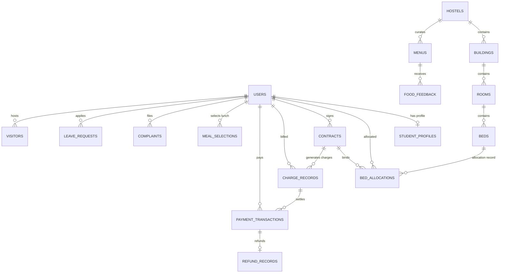

# Database Schema & Data Models: Smart Hostel & Mess Management System

> **Document Version**: 1.0.0  
> **Database Engine**: MongoDB 6.0+ with Mongoose ODM  
> **Status**: Approved for Technical Planning (Phase 1)

---

## 1. Schema Design Philosophy

1. **Normalized References for Core Entities**: Core operational entities (Hostels, Buildings, Rooms, Beds, Students, Contracts) use referenced `ObjectId` relations to prevent data duplication and enable atomic single-document updates.
2. **Embedded Subdocuments for Audit & History**: Where historical context belongs to a single document lifecycle (e.g., status transition history in a Complaint or allocation history in a Bed), embedded subdocuments are used to preserve temporal order without requiring join queries.
3. **Financial Ledger Integrity (Immutable Transactions vs. Guarded Projections)**:
   * `paymentTransactions` and `refundRecords` are strictly append-only, immutable ledgers. In-place updates and deletions are physically prohibited.
   * In `chargeRecords`, the billed financial facts (`amount`, `chargeType`, `billingPeriod`, `dueDate`, `studentId`) are immutable. Adjustments require credit/debit adjustment records.
   * Denormalized status fields on charges (`status`, `amountPaid`) are updated exclusively within multi-document ACID database transactions simultaneously with payment insertions.
   * Student outstanding balance is never stored as an arbitrary mutable number; it is dynamically derived from active charges, valid payments, reversals, and refunds.
4. **Strict Indexing & Partial Unique Filter Expressions**:
   * Unique partial indexes (`partialFilterExpression`) are used to prevent null-value collisions on optional fields (e.g., `studentId` on `users` only applies when `studentId` is of type `"string"`, allowing staff/admin accounts without student IDs).
   * Active constraints (such as preventing multiple active bed allocations for a student, or double-allocating a bed) are strictly enforced at the database engine level using partial unique indexes on `{ status: "ACTIVE" }`.
5. **Consistent UTC Timestamps & Local Calendar Dates**:
   * All absolute system timestamps (`createdAt`, `updatedAt`, `paymentDate`, `actualCheckIn`, `departureDate`) are stored in UTC (`Date`).
   * Operational dining dates (`menus.mealDate`, `mealSelections.mealDate`) are stored as ISO calendar date strings (`YYYY-MM-DD`) mapped to the hostel's configured IANA timezone (`applicationSettings.timezone`, e.g., `"Asia/Kolkata"`), preventing any midnight timezone-shifting ambiguity.


---

## 2. Entity Relationship Overview



---

## 3. Exhaustive Collection Specifications

---

### 3.1 `users`
* **Purpose**: Primary identity, authentication, credential storage, and RBAC authorization entity.
* **Fields & Types**:
  * `_id`: `ObjectId` (Primary Key)
  * `studentId`: `String` (Nullable for non-student staff, e.g., `"STU-202610001"`)
  * `email`: `String` (Required, lowercase, trimmed)
  * `passwordHash`: `String` (Required, Argon2id or bcrypt hash)
  * `role`: `String` (Required, Enum: `["SUPER_ADMIN", "HOSTEL_ADMIN", "STUDENT", "ACCOUNTS_MANAGER", "MESS_STAFF", "SECURITY_STAFF"]`)
  * `status`: `String` (Required, Enum: `["PENDING_ACTIVATION", "ACTIVE", "DEACTIVATED", "SUSPENDED"]`, Default: `"PENDING_ACTIVATION"`)
  * `activationTokenHash`: `String` (Nullable, SHA-256 hash of single-use activation secret)
  * `activationTokenExpires`: `Date` (Nullable, expiration timestamp)
  * `refreshTokenHash`: `String` (Nullable, SHA-256 hash of active refresh token for rotation)
  * `passwordResetTokenHash`: `String` (Nullable, SHA-256 hash for password recovery)
  * `passwordResetExpires`: `Date` (Nullable)
  * `lastLoginAt`: `Date` (Nullable)
  * `failedLoginAttempts`: `Number` (Default: `0`)
  * `lockUntil`: `Date` (Nullable, for account lockout on repeated brute force)
  * `createdAt`, `updatedAt`: `Date` (Standard timestamps)
* **Required Fields**: `email`, `passwordHash`, `role`, `status`
* **References**: None directly; referenced by profiles, allocations, logs.
* **Unique Indexes**:
  * `{ email: 1 }` (Unique)
  * `{ studentId: 1 }`, `{ unique: true, partialFilterExpression: { studentId: { $type: "string" } } }` (Unique Partial Index: strictly indexes only documents where `studentId` is of type `"string"`. This ensures administrator, warden, mess staff, and security accounts without student IDs can exist safely without `null`-key collisions that occur in standard sparse unique indexes).
* **Other Indexes**:
  * `{ role: 1, status: 1 }`
  * `{ activationTokenHash: 1 }`
* **Data Retention**: Soft delete only (`status: "DEACTIVATED"`). Never physically deleted to preserve foreign-key relational integrity across past financial and room allocations.

---

### 3.2 `studentProfiles`
* **Purpose**: Detailed personal, academic, emergency contact, masked KYC, and residential profile data.
* **Fields & Types**:
  * `_id`: `ObjectId` (Primary Key)
  * `userId`: `ObjectId` (Required, Ref: `users`)
  * `fullName`: `String` (Required, trimmed)
  * `registeredPhone`: `String` (Required, 10-digit format; non-unique to allow shared family numbers)
  * `alternatePhone`: `String` (Optional)
  * `dateOfBirth`: `Date` (Optional)
  * `gender`: `String` (Enum: `["MALE", "FEMALE", "OTHER"]`)
  * `bloodGroup`: `String` (Enum: `["A+", "A-", "B+", "B-", "AB+", "AB-", "O+", "O-", "UNKNOWN"]`)
  * `dietaryPreference`: `String` (Enum: `["VEGETARIAN", "NON_VEGETARIAN", "EGGITARIAN", "VEGAN"]`, Default: `"VEGETARIAN"`)
  * `academicInfo`: `Object`:
    * `rollNumber`: `String` (Institute roll number)
    * `course`: `String` (e.g., `"BTech"`)
    * `branch`: `String` (e.g., `"CSE-AIML"`)
    * `yearOfStudy`: `Number` (1 to 4)
  * `addresses`: `Object`:
    * `permanent`: `Object` (`{ street, city, state, postalCode, country }`)
    * `current`: `Object` (`{ street, city, state, postalCode, country }`)
  * `emergencyContact`: `Object` (Required):
    * `name`: `String` (Required)
    * `relationship`: `String` (Required, e.g., `"Father"`)
    * `phone`: `String` (Required)
    * `email`: `String` (Optional)
  * `bankDetails`: `Object` (Optional, encrypted or masked for security deposit refunds):
    * `accountHolderName`: `String`
    * `maskedAccountNumber`: `String` (e.g., `"XXXXXX1234"`)
    * `ifscCode`: `String`
    * `bankName`: `String`
  * `kycDocuments`: `Array` of `Object`:
    * `documentType`: `String` (Enum: `["AADHAAR", "PAN", "COLLEGE_ID", "PASSPORT"]`)
    * `maskedIdNumber`: `String` (e.g., `"XXXX-XXXX-9876"`)
    * `fileKey`: `String` (Internal storage key, never a public URL)
    * `verified`: `Boolean` (Default: `false`)
    * `verifiedByAdminId`: `ObjectId` (Ref: `users`, Nullable)
  * `profilePictureKey`: `String` (Nullable storage key)
  * `createdAt`, `updatedAt`: `Date`
* **Required Fields**: `userId`, `fullName`, `registeredPhone`, `emergencyContact`
* **References**: `userId` -> `users._id`
* **Unique Indexes**:
  * `{ userId: 1 }` (Unique)
* **Other Important Indexes**:
  * `{ registeredPhone: 1 }` (Non-unique index for fast lookup: allows siblings, cousins, or family members residing in the hostel to share a primary family contact phone number without constraint collision).
* **Identity & Ownership Verification Policy**:
  * Registered phone numbers are treated purely as operational and emergency contact fields.
  * Account ownership, authentication, and authorization are verified independently through unique credentials (`users.studentId` or `users.email`), password hashes, and cryptographic JWT sessions. A phone number is never treated as a substitute for an authentication secret.
* **Access Permissions**:
  * Students can read all own fields; can edit personal/contact/emergency fields.
  * Admins can read and verify KYC.
  * General API responses mask `bankDetails` and `maskedIdNumber`.

---

### 3.3 `studentIdCounters`
* **Purpose**: Enforces atomic, race-condition-free sequential student ID generation per calendar month (`STU-YYYYMM` + auto-expanding sequence, e.g., `STU-202610001`, `STU-202610999`, `STU-2026101000`).
* **Fields & Types**:
  * `_id`: `ObjectId`
  * `yearMonth`: `String` (Required, format `"YYYYMM"`, e.g., `"202610"`)
  * `seq`: `Number` (Required, Default: `0`, atomically incremented)
  * `createdAt`, `updatedAt`: `Date`
* **Required Fields**: `yearMonth`, `seq`
* **Unique Indexes**:
  * `{ yearMonth: 1 }` (Unique)
* **Concurrency Guarantee & Simultaneous Creation Safety**:
  * Incremented atomically using:
    `findOneAndUpdate({ yearMonth }, { $inc: { seq: 1 } }, { upsert: true, new: true, setDefaultsOnInsert: true })`
  * **First-Time Month Creation Race Condition**: If multiple concurrent registration requests arrive at the start of a new month, MongoDB may throw a duplicate key error (`E11000`) on the upsert of the unique `{ yearMonth }` index. The backend service wraps counter acquisition in a dedicated retry loop (up to 3 attempts), ensuring that whichever thread won the initial upsert sets the document, while concurrent threads seamlessly retry and atomically increment `seq`.
* **Automatic Sequence Expansion & ID Permanence**:
  * The monthly sequence starts at `1` and is zero-padded to at least 3 digits for display (e.g., `001`, `042`, `999`). When registrations exceed 999 in a single month, the sequence automatically expands beyond 3 digits (`1000`, `1001`, ...) without any artificial rejection or registration stoppage.
  * **No monthly registration cap is enforced by the counter service.** The counter is strictly monotonically increasing and never rolled back.
  * **Never Reuse Issued IDs**: Once `seq` is incremented by `$inc`, the resulting ID is permanently assigned, regardless of whether the downstream registration workflow succeeds or fails. IDs are never decremented, reused, or recycled — guaranteeing monotonic audit safety.


---

### 3.4 `hostels`
* **Purpose**: Top-level residential campus or property facility.
* **Fields & Types**:
  * `_id`: `ObjectId`
  * `name`: `String` (Required, e.g., `"Boys Hostel Block Alpha"`)
  * `code`: `String` (Required, unique short code, e.g., `"BH-A"`)
  * `genderType`: `String` (Enum: `["MALE", "FEMALE", "CO_ED"]`)
  * `wardenInChargeId`: `ObjectId` (Ref: `users`, Nullable)
  * `contactPhone`: `String`
  * `contactEmail`: `String`
  * `address`: `Object` (`{ street, city, state, postalCode }`)
  * `amenities`: `[String]` (e.g., `["WIFI", "GYM", "LAUNDRY", "RO_WATER"]`)
  * `isActive`: `Boolean` (Default: `true`)
  * `createdAt`, `updatedAt`: `Date`
* **Unique Indexes**: `{ code: 1 }`, `{ name: 1 }`

---

### 3.5 `buildings`
* **Purpose**: Represents distinct blocks, towers, or wings within a hostel complex.
* **Fields & Types**:
  * `_id`: `ObjectId`
  * `hostelId`: `ObjectId` (Required, Ref: `hostels`)
  * `name`: `String` (Required, e.g., `"Wing A"`)
  * `totalFloors`: `Number` (Required, min: 1)
  * `status`: `String` (Enum: `["ACTIVE", "UNDER_RENOVATION", "INACTIVE"]`, Default: `"ACTIVE"`)
  * `createdAt`, `updatedAt`: `Date`
* **Unique Indexes**: `{ hostelId: 1, name: 1 }` (Compound Unique)

---

### 3.6 `rooms`
* **Purpose**: Represents physical living quarters within a building/floor.
* **Fields & Types**:
  * `_id`: `ObjectId`
  * `hostelId`: `ObjectId` (Required, Ref: `hostels`)
  * `buildingId`: `ObjectId` (Required, Ref: `buildings`)
  * `roomNumber`: `String` (Required, e.g., `"204"`)
  * `floor`: `Number` (Required, e.g., `2`)
  * `roomType`: `String` (Enum: `["SINGLE", "DOUBLE", "TRIPLE", "FOUR_BED"]`, Required)
  * `capacity`: `Number` (Required, strictly derived from `roomType`: SINGLE=1, DOUBLE=2, TRIPLE=3, FOUR_BED=4)
  * `occupiedBeds`: `Number` (Default: `0`, atomically maintained; invariant: `0 <= occupiedBeds <= capacity`)
  * `baseMonthlyRent`: `Number` (Required, e.g., `8500`)
  * `status`: `String` (Enum: `["AVAILABLE", "FULL", "UNDER_MAINTENANCE", "DECOMMISSIONED"]`, Default: `"AVAILABLE"`)
  * `maintenanceReason`: `String` (Nullable)
  * `createdAt`, `updatedAt`: `Date`
* **Unique Indexes**: `{ hostelId: 1, buildingId: 1, roomNumber: 1 }` (Compound Unique)
* **Other Indexes**: `{ hostelId: 1, status: 1 }`, `{ buildingId: 1, floor: 1 }`
* **Room-Bed Capacity Invariant**:
  * The physical bed inventory for any room must strictly equal its configured capacity: `count(beds where roomId = room._id) === room.capacity`.
  * Provisioning a room automatically seeds the exact number of beds (`Bed A`, `Bed B`, etc.).

---

### 3.7 `beds`
* **Purpose**: Discrete, assignable sleep unit within a room.
* **Fields & Types**:
  * `_id`: `ObjectId`
  * `roomId`: `ObjectId` (Required, Ref: `rooms`)
  * `hostelId`: `ObjectId` (Required, Ref: `hostels`)
  * `bedLabel`: `String` (Required, e.g., `"A"`, `"B"`, `"C"`)
  * `status`: `String` (Enum: `["VACANT", "OCCUPIED", "UNDER_MAINTENANCE", "BLOCKED"]`, Default: `"VACANT"`)
  * `currentAllocationId`: `ObjectId` (Nullable, Ref: `bedAllocations`)
  * `createdAt`, `updatedAt`: `Date`
* **Unique Indexes**: `{ roomId: 1, bedLabel: 1 }` (Compound Unique)
* **Other Indexes**: `{ hostelId: 1, status: 1 }`, `{ status: 1 }`

---

### 3.8 `bedAllocations`
* **Purpose**: Historical and active log of room and bed assignments to students.
* **Fields & Types**:
  * `_id`: `ObjectId`
  * `studentId`: `ObjectId` (Required, Ref: `users`)
  * `contractId`: `ObjectId` (Required, Ref: `contracts`)
  * `hostelId`: `ObjectId` (Required, Ref: `hostels`)
  * `buildingId`: `ObjectId` (Required, Ref: `buildings`)
  * `roomId`: `ObjectId` (Required, Ref: `rooms`)
  * `bedId`: `ObjectId` (Required, Ref: `beds`)
  * `startDate`: `Date` (Required)
  * `endDate`: `Date` (Nullable, populated on transfer/checkout)
  * `status`: `String` (Enum: `["ACTIVE", "TRANSFERRED", "CHECKED_OUT"]`, Default: `"ACTIVE"`)
  * `checkInTimestamp`: `Date` (Nullable, actual physical check-in)
  * `checkOutTimestamp`: `Date` (Nullable, actual physical check-out)
  * `allocatedByAdminId`: `ObjectId` (Required, Ref: `users`)
  * `remarks`: `String` (Optional, e.g., room transfer reason)
  * `createdAt`, `updatedAt`: `Date`
* **Unique Partial Indexes (Concurrency & Integrity Enforcement)**:
  * `{ studentId: 1 }, { unique: true, partialFilterExpression: { status: "ACTIVE" } }` (Database Engine Guarantee: Physically impossible for a single student to hold more than one active bed allocation at any time).
  * `{ bedId: 1 }, { unique: true, partialFilterExpression: { status: "ACTIVE" } }` (Database Engine Guarantee: Physically impossible for two concurrent administrators or race conditions to allocate the same bed to multiple residents).
* **Three-Tier Allocation Defense Architecture**:
  1. **Tier 1 (Application Validation)**: Asserts that target bed `status === "VACANT"`, target room `occupiedBeds < capacity`, and student has no active allocation.
  2. **Tier 2 (ACID Database Transaction)**: All mutations (updating bed status to `OCCUPIED`, incrementing room `occupiedBeds`, creating `bedAllocations` record, updating contract) execute inside `session.withTransaction()`. If concurrent allocations target the same bed, MongoDB's write conflict detection rolls back one transaction cleanly.
  3. **Tier 3 (Database Partial Unique Indexes)**: Even if application logic fails or is bypassed, MongoDB rejects duplicate active allocations with duplicate key error `E11000`.
* **Safe Room Transfer & Checkout Procedures**:
  * **Room Transfer Procedure**: Inside an ACID transaction, (1) previous allocation status is set to `"TRANSFERRED"` with `endDate = now()`, (2) previous bed is set to `"VACANT"` and previous room `occupiedBeds` decremented by 1, (3) target bed is set to `"OCCUPIED"` and target room `occupiedBeds` incremented by 1, (4) new `bedAllocations` record is created with `status: "ACTIVE"`, (5) contract is updated with new room/bed.
  * **Checkout Procedure**: (1) Verify ledger balance is `<= 0`, (2) inside an ACID transaction, active allocation status is set to `"CHECKED_OUT"` with `endDate = now()`, (3) bed is set to `"VACANT"`, (4) room `occupiedBeds` decremented by 1, (5) contract marked `"COMPLETED"` with `duesCleared = true`.
* **Retention Policy**: Strictly append-only historical record. Documents are never deleted. Every transition stamps `endDate` and updates `status`, preserving an unbroken historical timeline of student residency.

---

### 3.9 `contracts`
* **Purpose**: Enforces legal residency terms, tenures, lock-ins, notice periods, and exit approvals.
* **Fields & Types**:
  * `_id`: `ObjectId`
  * `studentId`: `ObjectId` (Required, Ref: `users`)
  * `hostelId`: `ObjectId` (Required, Ref: `hostels`)
  * `roomId`: `ObjectId` (Nullable initially, Ref: `rooms`)
  * `bedId`: `ObjectId` (Nullable initially, Ref: `beds`)
  * `startDate`: `Date` (Required)
  * `endDate`: `Date` (Required)
  * `tenureMonths`: `Number` (Required, e.g., 12)
  * `lockInUntilDate`: `Date` (Required, date before which premature exit forfeits deposit)
  * `noticePeriodDays`: `Number` (Default: 30)
  * `monthlyRentAmount`: `Number` (Required)
  * `securityDepositAmount`: `Number` (Required)
  * `status`: `String` (Enum: `["DRAFT", "ACTIVE", "EXIT_REQUESTED", "EXIT_APPROVED", "COMPLETED", "TERMINATED"]`, Default: `"DRAFT"`)
  * `exitRequest`: `Object` (Nullable):
    * `requestedExitDate`: `Date`
    * `reason`: `String`
    * `submissionTimestamp`: `Date`
    * `earlyExitPenaltyAmount`: `Number` (Calculated by system)
    * `approvedByAdminId`: `ObjectId` (Ref: `users`, Nullable)
    * `approvalTimestamp`: `Date` (Nullable)
    * `adminRemarks`: `String`
  * `duesCleared`: `Boolean` (Default: `false`)
  * `duesClearedAt`: `Date` (Nullable)
  * `createdAt`, `updatedAt`: `Date`
* **Indexes**: `{ studentId: 1, status: 1 }`, `{ hostelId: 1, status: 1 }`
* **Retention**: Permanent historical record. Never deleted.

---

### 3.10 `chargeRecords`
* **Purpose**: Debit side of the financial ledger. Represents billed dues/invoices issued to a student.
* **Fields & Types**:
  * `_id`: `ObjectId`
  * `chargeNumber`: `String` (Required, unique human-friendly ID, e.g., `"CHG-202610-0042"`)
  * `studentId`: `ObjectId` (Required, Ref: `users`)
  * `contractId`: `ObjectId` (Required, Ref: `contracts`)
  * `chargeType`: `String` (Enum: `["MONTHLY_RENT", "SECURITY_DEPOSIT", "MESS_FEE", "LATE_FINE", "DAMAGE_PENALTY", "UTILITIES", "WAIVER_ADJUSTMENT"]`, Required)
  * `billingPeriod`: `String` (e.g., `"2026-10"`, Nullable for one-time charges)
  * `amount`: `Number` (Required, positive number; immutable once billed)
  * `dueDate`: `Date` (Required)
  * `status`: `String` (Enum: `["UNPAID", "PARTIALLY_PAID", "PAID", "CANCELLED"]`, Default: `"UNPAID"`)
  * `amountPaid`: `Number` (Default: `0`; denormalized payment allocation sum)
  * `cancellationReason`: `String` (Nullable, required if status is `"CANCELLED"`)
  * `cancelledByAdminId`: `ObjectId` (Nullable, Ref: `users`)
  * `generatedByAdminId`: `ObjectId` (Nullable, system automated or admin Ref: `users`)
  * `notes`: `String`
  * `createdAt`, `updatedAt`: `Date`
* **Unique Indexes**: `{ chargeNumber: 1 }` (Unique)
* **Compound Indexes**: `{ studentId: 1, status: 1 }`, `{ studentId: 1, billingPeriod: 1, chargeType: 1 }`
* **Mutability & Transaction Rules**:
  * **Immutable Fields**: `amount`, `chargeType`, `billingPeriod`, `dueDate`, `studentId`, `contractId`. These billed financial parameters cannot be modified in-place after issuance.
  * **Mutable Projection Fields (`status`, `amountPaid`)**: Maintained strictly for query performance (e.g., finding unpaid bills). **Critical Rule**: These fields must NEVER be updated in isolation. They are updated exclusively inside an atomic MongoDB multi-document transaction (`session.withTransaction()`) simultaneously with the creation of the corresponding `paymentTransactions` document.
  * **Correction & Waiver Policy**: To correct an overcharge or waive a fine, administrators cannot edit `amount`. They must either (1) issue an offsetting Credit Adjustment record (`chargeType: "WAIVER_ADJUSTMENT"` with negative/offsetting credit), or (2) set `status: "CANCELLED"` with mandatory `cancellationReason` and `cancelledByAdminId`.

---

### 3.11 `paymentTransactions`
* **Purpose**: Credit side of the financial ledger. Strictly append-only, immutable receipt ledger.
* **Fields & Types**:
  * `_id`: `ObjectId`
  * `receiptNumber`: `String` (Required, unique e.g., `"REC-202610-00109"`)
  * `studentId`: `ObjectId` (Required, Ref: `users`)
  * `chargeRecordId`: `ObjectId` (Nullable if payment covers multiple dues, Ref: `chargeRecords`)
  * `amountPaid`: `Number` (Required, positive currency amount)
  * `paymentMethod`: `String` (Enum: `["CASH", "UPI", "BANK_TRANSFER", "CHEQUE", "DEMAND_DRAFT"]`, Required)
  * `referenceNumber`: `String` (Required, Bank UTR or transaction ID)
  * `paymentDate`: `Date` (Required, UTC timestamp)
  * `recordedByAdminId`: `ObjectId` (Required, Ref: `users`)
  * `status`: `String` (Enum: `["SUCCESS", "REVERSED"]`, Default: `"SUCCESS"`)
  * `isReversal`: `Boolean` (Default: `false`)
  * `reversalReason`: `String` (Nullable, required if `isReversal: true`)
  * `reversedTransactionId`: `ObjectId` (Nullable, Ref: `paymentTransactions`)
  * `notes`: `String`
  * `createdAt`, `updatedAt`: `Date`
* **Unique Indexes**:
  * `{ receiptNumber: 1 }` (Unique)
  * `{ referenceNumber: 1 }` (Unique: prevents duplicate recording of identical bank UTR)
* **Compound Indexes**: `{ studentId: 1, paymentDate: -1 }`
* **Strict Immutability & Reversal Workflow**:
  * Documents in this collection are **100% immutable**. In-place updates and physical deletions are prohibited.
  * If an administrator enters an incorrect amount or a cheque bounces, the administrator cannot edit the record. Instead, an atomic transaction inserts an offsetting reversal record (`isReversal: true`, `status: "REVERSED"`, `reversedTransactionId: originalTx._id`) and updates the associated `chargeRecords.amountPaid` and `chargeRecords.status` accordingly.

---

### 3.12 `refundRecords`
* **Purpose**: Tracks deposit returns, excess payment refunds, and exit settlements. Strictly append-only.
* **Fields & Types**:
  * `_id`: `ObjectId`
  * `refundNumber`: `String` (Required, unique e.g., `"REF-202610-0012"`)
  * `studentId`: `ObjectId` (Required, Ref: `users`)
  * `originalPaymentId`: `ObjectId` (Nullable, Ref: `paymentTransactions`)
  * `contractId`: `ObjectId` (Required, Ref: `contracts`)
  * `amount`: `Number` (Required, positive number)
  * `reason`: `String` (Enum: `["SECURITY_DEPOSIT_RETURN", "OVERPAYMENT_REFUND", "CONTRACT_CANCELLATION"]`)
  * `paymentMethod`: `String` (Enum: `["BANK_TRANSFER", "UPI", "CHEQUE"]`)
  * `bankReferenceNumber`: `String` (Required)
  * `approvedByAdminId`: `ObjectId` (Required, Ref: `users`)
  * `refundDate`: `Date` (Required, UTC timestamp)
  * `createdAt`, `updatedAt`: `Date`
* **Unique Indexes**: `{ refundNumber: 1 }`
* **Retention**: Strictly immutable append-only ledger.

---

### 3.12.1 Financial Balance & Partial Payment Mechanics
* **Dynamic Ledger Balance Formula**:
  The system computes outstanding student balances dynamically on the server:
  $$\text{Outstanding Balance} = \sum_{\substack{\text{charges} \\ \text{status} \neq \text{"CANCELLED"}}} \text{amount} - \sum_{\substack{\text{payments} \\ \text{status} = \text{"SUCCESS"}}} \text{amountPaid} + \sum_{\substack{\text{payments} \\ \text{isReversal} = \text{true}}} \text{amountPaid} + \sum \text{refunds}$$
* **Partial Payment Execution**:
  * When a payment of ₹5,000 is received against a ₹8,500 charge:
    1. An immutable `paymentTransactions` document is inserted for ₹5,000.
    2. Inside the same ACID transaction, `chargeRecords.amountPaid` is incremented by ₹5,000 (now ₹5,000).
    3. `chargeRecords.status` transitions from `"UNPAID"` to `"PARTIALLY_PAID"`.
    4. Remaining unpaid balance on that specific invoice = `amount - amountPaid` = ₹3,500.
  * When a subsequent ₹3,500 payment is received:
    1. Second `paymentTransactions` document is inserted for ₹3,500.
    2. Inside the same ACID transaction, `chargeRecords.amountPaid` becomes ₹8,500.
    3. `chargeRecords.status` transitions from `"PARTIALLY_PAID"` to `"PAID"`.
* **Zero Client Trust**: The frontend is never permitted to transmit balance or total calculations. All dues and balances are calculated and verified server-side.

---

### 3.13 `menus`
* **Purpose**: Day-wise rotational meal menus curated by hostel administration.
* **Fields & Types**:
  * `_id`: `ObjectId`
  * `hostelId`: `ObjectId` (Required, Ref: `hostels`)
  * `mealDate`: `String` (Required, format `"YYYY-MM-DD"`, representing the calendar day in the hostel's local timezone)
  * `dateAnchor`: `Date` (Normalized UTC timestamp representing the calendar date anchor for range queries)
  * `mealType`: `String` (Enum: `["BREAKFAST", "LUNCH", "SNACKS", "DINNER"]`, Required)
  * `title`: `String` (e.g., `"Paneer Butter Masala Special"`)
  * `items`: `[String]` (e.g., `["Jeera Rice", "Dal Makhani", "Paneer Gravy", "Salad", "Gulab Jamun"]`)
  * `isSpecialMeal`: `Boolean` (Default: `false`)
  * `dietaryTags`: `[String]` (e.g., `["VEG", "CONTAINS_DAIRY"]`)
  * `createdAt`, `updatedAt`: `Date` (Standard UTC timestamps)
* **Unique Indexes**: `{ hostelId: 1, mealDate: 1, mealType: 1 }` (Compound Unique: prevents duplicate menus for the same hostel, meal type, and local calendar date)

---

### 3.14 `mealSelections`
* **Purpose**: Tracks student dining choices for lunch (Dine-in vs. Packed Tiffin).
* **Fields & Types**:
  * `_id`: `ObjectId`
  * `studentId`: `ObjectId` (Required, Ref: `users`)
  * `hostelId`: `ObjectId` (Required, Ref: `hostels`)
  * `mealDate`: `String` (Required, format `"YYYY-MM-DD"`, representing the target meal calendar day in the hostel's local timezone)
  * `mealType`: `String` (Default: `"LUNCH"`, Enum: `["LUNCH"]`)
  * `selection`: `String` (Enum: `["DINE_IN", "TIFFIN"]`, Required, Default: `"DINE_IN"`)
  * `isDefault`: `Boolean` (Required, `true` if auto-assigned by system, `false` if student explicitly selected)
  * `selectionTimestamp`: `Date` (Required, UTC timestamp when choice was registered or modified)
  * `cutoffPassed`: `Boolean` (Default: `false`)
  * `isOverridden`: `Boolean` (Default: `false`)
  * `overriddenByAdminId`: `ObjectId` (Nullable, Ref: `users`)
  * `overrideReason`: `String` (Nullable, mandatory if `isOverridden: true`)
  * `overrideTimestamp`: `Date` (Nullable, UTC timestamp)
  * `previousSelection`: `String` (Nullable)
  * `createdAt`, `updatedAt`: `Date` (Standard UTC timestamps)
* **Unique Indexes**: `{ studentId: 1, mealDate: 1, mealType: 1 }` (Compound Unique: guarantees exactly one lunch record per student per calendar day)
* **Compound Indexes**: `{ hostelId: 1, mealDate: 1, selection: 1 }` (Optimizes daily kitchen aggregation and tiffin packing roster queries)

---

### 3.15 `foodFeedback`
* **Purpose**: Student ratings, quality reviews, and food-related complaints.
* **Fields & Types**:
  * `_id`: `ObjectId`
  * `studentId`: `ObjectId` (Required, Ref: `users`)
  * `hostelId`: `ObjectId` (Required, Ref: `hostels`)
  * `date`: `Date` (Required)
  * `mealType`: `String` (Enum: `["BREAKFAST", "LUNCH", "SNACKS", "DINNER"]`, Required)
  * `rating`: `Number` (Required, 1 to 5)
  * `tasteRating`: `Number` (Optional, 1 to 5)
  * `hygieneRating`: `Number` (Optional, 1 to 5)
  * `comments`: `String`
  * `isEscalatedToComplaint`: `Boolean` (Default: `false`)
  * `complaintId`: `ObjectId` (Nullable, Ref: `complaints`)
  * `createdAt`, `updatedAt`: `Date`
* **Compound Indexes**: `{ hostelId: 1, date: -1 }`, `{ studentId: 1, date: -1 }`

---

### 3.16 `complaints`
* **Purpose**: Maintenance and residential grievances tracking.
* **Fields & Types**:
  * `_id`: `ObjectId`
  * `ticketNumber`: `String` (Required, unique e.g., `"CMP-202610-008"`)
  * `studentId`: `ObjectId` (Required, Ref: `users`)
  * `hostelId`: `ObjectId` (Required, Ref: `hostels`)
  * `roomId`: `ObjectId` (Required, Ref: `rooms`)
  * `category`: `String` (Enum: `["PLUMBING", "ELECTRICAL", "CARPENTRY", "MESS_FOOD", "CLEANLINESS", "WIFI_INTERNET", "OTHER"]`, Required)
  * `title`: `String` (Required, max: 120 chars)
  * `description`: `String` (Required, max: 2000 chars)
  * `priority`: `String` (Enum: `["LOW", "MEDIUM", "HIGH", "URGENT"]`, Default: `"MEDIUM"`)
  * `attachmentKeys`: `[String]` (Up to 3 storage keys for photos)
  * `status`: `String` (Enum: `["OPEN", "IN_PROGRESS", "RESOLVED", "CLOSED", "REJECTED"]`, Default: `"OPEN"`)
  * `assignedStaffName`: `String` (Nullable)
  * `adminRemarks`: `String` (Nullable)
  * `resolutionDetails`: `String` (Nullable)
  * `resolvedAt`: `Date` (Nullable)
  * `studentFeedback`: `Object` (Nullable):
    * `rating`: `Number` (1 to 5)
    * `comment`: `String`
    * `submittedAt`: `Date`
  * `statusHistory`: `Array` of `Object`:
    * `status`: `String`
    * `changedBy`: `ObjectId` (Ref: `users`)
    * `remarks`: `String`
    * `timestamp`: `Date`
  * `createdAt`, `updatedAt`: `Date`
* **Unique Indexes**: `{ ticketNumber: 1 }`
* **Compound Indexes**: `{ studentId: 1, status: 1 }`, `{ hostelId: 1, status: 1, priority: 1 }`

---

### 3.17 `leaveRequests`
* **Purpose**: Digital gate passes, overnight leaves, and vacation tracking.
* **Fields & Types**:
  * `_id`: `ObjectId`
  * `studentId`: `ObjectId` (Required, Ref: `users`)
  * `hostelId`: `ObjectId` (Required, Ref: `hostels`)
  * `leaveType`: `String` (Enum: `["NIGHT_OUT", "WEEKEND", "VACATION", "EMERGENCY"]`, Required)
  * `departureDate`: `Date` (Required)
  * `expectedReturnDate`: `Date` (Required)
  * `actualReturnDate`: `Date` (Nullable)
  * `reason`: `String` (Required)
  * `destinationAddress`: `String` (Required)
  * `emergencyContactPhone`: `String` (Required)
  * `parentConsentAcknowledged`: `Boolean` (Default: `false`)
  * `status`: `String` (Enum: `["PENDING", "APPROVED", "REJECTED", "EXPIRED", "COMPLETED"]`, Default: `"PENDING"`)
  * `reviewedByAdminId`: `ObjectId` (Nullable, Ref: `users`)
  * `adminRemarks`: `String` (Nullable)
  * `reviewedAt`: `Date` (Nullable)
  * `createdAt`, `updatedAt`: `Date`
* **Compound Indexes**: `{ studentId: 1, status: 1 }`, `{ hostelId: 1, status: 1 }`, `{ departureDate: 1 }`

---

### 3.18 `visitors`
* **Purpose**: Security gate visitor logging and student guest tracking.
* **Fields & Types**:
  * `_id`: `ObjectId`
  * `studentId`: `ObjectId` (Required, Ref: `users`)
  * `hostelId`: `ObjectId` (Required, Ref: `hostels`)
  * `visitorName`: `String` (Required)
  * `relationship`: `String` (Required, e.g., `"Parent"`, `"Sibling"`, `"Local Guardian"`)
  * `contactNumber`: `String` (Required)
  * `idProofType`: `String` (Enum: `["AADHAAR", "DRIVING_LICENSE", "VOTER_ID", "PASSPORT", "OTHER"]`)
  * `idProofNumber`: `String` (Masked, optional)
  * `purpose`: `String` (Required)
  * `expectedArrival`: `Date` (Required)
  * `actualCheckIn`: `Date` (Nullable, recorded by gate staff)
  * `actualCheckOut`: `Date` (Nullable, recorded by gate staff)
  * `recordedByStaffId`: `ObjectId` (Nullable, Ref: `users`)
  * `status`: `String` (Enum: `["PRE_REGISTERED", "INSIDE_HOSTEL", "CHECKED_OUT", "REJECTED"]`, Default: `"PRE_REGISTERED"`)
  * `createdAt`, `updatedAt`: `Date`
* **Compound Indexes**: `{ studentId: 1, createdAt: -1 }`, `{ hostelId: 1, status: 1 }`

---

### 3.19 `notices`
* **Purpose**: Digital notice board for hostel bulletins and announcements.
* **Fields & Types**:
  * `_id`: `ObjectId`
  * `title`: `String` (Required)
  * `content`: `String` (Required, Markdown supported)
  * `targetScope`: `String` (Enum: `["ALL_HOSTELS", "HOSTEL_SPECIFIC", "BUILDING_SPECIFIC"]`, Default: `"ALL_HOSTELS"`)
  * `hostelId`: `ObjectId` (Nullable if `ALL_HOSTELS`, Ref: `hostels`)
  * `buildingId`: `ObjectId` (Nullable, Ref: `buildings`)
  * `priority`: `String` (Enum: `["NORMAL", "IMPORTANT", "URGENT"]`, Default: `"NORMAL"`)
  * `publishedByAdminId`: `ObjectId` (Required, Ref: `users`)
  * `attachmentKeys`: `[String]`
  * `expiresAt`: `Date` (Nullable)
  * `createdAt`, `updatedAt`: `Date`
* **Compound Indexes**: `{ targetScope: 1, hostelId: 1, createdAt: -1 }`

---

### 3.20 `notifications`
* **Purpose**: User-specific in-app notification inbox.
* **Fields & Types**:
  * `_id`: `ObjectId`
  * `userId`: `ObjectId` (Required, Ref: `users`)
  * `title`: `String` (Required)
  * `message`: `String` (Required)
  * `type`: `String` (Enum: `["INFO", "SUCCESS", "WARNING", "ACTION_REQUIRED"]`, Default: `"INFO"`)
  * `relatedModule`: `String` (Enum: `["FINANCES", "ALLOCATIONS", "MESS", "COMPLAINTS", "LEAVE", "NOTICES", "SYSTEM"]`)
  * `link`: `String` (Optional frontend deep link)
  * `isRead`: `Boolean` (Default: `false`)
  * `readAt`: `Date` (Nullable)
  * `createdAt`: `Date` (TTL index for automatic cleanup after 90 days)
* **Compound Indexes**: `{ userId: 1, isRead: 1, createdAt: -1 }`
* **TTL Index**: `{ createdAt: 1 }` with `expireAfterSeconds: 7776000` (90 days)

---

### 3.21 `auditLogs`
* **Purpose**: Forensic audit trail capturing sensitive administrative actions.
* **Fields & Types**:
  * `_id`: `ObjectId`
  * `actorId`: `ObjectId` (Required, Ref: `users`)
  * `actorRole`: `String` (Required)
  * `action`: `String` (Required, e.g., `"OVERRIDE_LUNCH_SELECTION"`, `"TRANSFER_ROOM"`, `"REVERSE_PAYMENT"`, `"APPROVE_EXIT"`)
  * `targetCollection`: `String` (Required, e.g., `"mealSelections"`)
  * `targetDocumentId`: `ObjectId` (Required)
  * `previousState`: `Object` (Snapshot before change)
  * `newState`: `Object` (Snapshot after change)
  * `reason`: `String` (Mandatory for overrides and reversals)
  * `ipAddress`: `String`
  * `userAgent`: `String`
  * `timestamp`: `Date` (Default: `Date.now`)
* **Indexes**: `{ targetDocumentId: 1 }`, `{ actorId: 1, timestamp: -1 }`, `{ action: 1, timestamp: -1 }`
* **Retention**: Strictly immutable. WORM (Write Once, Read Many).

---

### 3.22 `applicationSettings`
* **Purpose**: Runtime configuration for operational policies, timezones, and dining cutoffs per hostel or globally.
* **Fields & Types**:
  * `_id`: `ObjectId`
  * `hostelId`: `ObjectId` (Nullable if global default, Ref: `hostels`)
  * `timezone`: `String` (Required, IANA Timezone identifier, e.g., `"Asia/Kolkata"`, Default: `"Asia/Kolkata"`)
  * `lunchCutoffTime`: `String` (Default: `"09:30"`, 24-hr `HH:mm` format in local hostel timezone)
  * `defaultNoticePeriodDays`: `Number` (Default: `30`)
  * `defaultLockInPeriodMonths`: `Number` (Default: `6`)
  * `currentAcademicYear`: `String` (e.g., `"2026-2027"`)
  * `gracePeriodDuesDays`: `Number` (Default: `5`)
  * `allowStudentVisitorPreRegistration`: `Boolean` (Default: `true`)
  * `updatedByAdminId`: `ObjectId` (Ref: `users`)
  * `createdAt`, `updatedAt`: `Date` (Standard UTC timestamps)
* **Unique Indexes**: `{ hostelId: 1 }` (Sparse Unique)

---

## 4. Cross-Collection Invariants, Index Validations & Retention Safeguards

### 4.1 Room-Bed Capacity Integrity & Inventory Consistency
* **Strict Mathematical Invariant**:
  $$\text{count}(\text{beds where } \text{roomId} = \text{room.\_id}) \equiv \text{room.capacity}$$
  $$\text{room.occupiedBeds} \equiv \text{count}(\text{beds where } \text{roomId} = \text{room.\_id and status} = \text{"OCCUPIED"})$$
  $$0 \le \text{room.occupiedBeds} \le \text{room.capacity}$$
* **Automated Provisioning**: When a room is created with `roomType: "DOUBLE"`, the service automatically provisions exactly 2 beds (`Bed A` and `Bed B`). Deleting or adding beds independently outside capacity adjustments is prevented by application validation.

### 4.2 Allocation Concurrency & Double-Booking Elimination
* **Database Engine Guarantee via Partial Indexes**:
  * `{ bedId: 1 }, { unique: true, partialFilterExpression: { status: "ACTIVE" } }`: Prevents duplicate concurrent allocations on the same bed.
  * `{ studentId: 1 }, { unique: true, partialFilterExpression: { status: "ACTIVE" } }`: Prevents a student from holding multiple active bed allocations across any hostel.
* **ACID Transaction Scope**:
  Room allocation, transfer, and checkout must execute within `session.withTransaction()`. If two concurrent requests attempt to reserve the same bed, MongoDB's write-conflict detection aborts one transaction with an automatic rollback, completely shielding against race conditions.

### 4.3 Financial Immutability & Ledger Retention
* **Document Mutability Rules**:
  | Collection | In-Place Updates Allowed? | Permitted Updates | Guarding Mechanism |
  | :--- | :---: | :--- | :--- |
  | `paymentTransactions` | ❌ **PROHIBITED** | None (100% Immutable) | Append-only ledger; corrections require offsetting reversal record |
  | `refundRecords` | ❌ **PROHIBITED** | None (100% Immutable) | Append-only ledger |
  | `chargeRecords` | ⚠️ **PARTIAL** | Only `status` & `amountPaid` projections | Updated strictly inside multi-document ACID transactions with payment transactions |
  | `auditLogs` | ❌ **PROHIBITED** | None (100% Immutable WORM) | Append-only forensic log |
* **Balance Calculation Invariant**: Outstanding balance is never an editable client field. It is always calculated dynamically by summing non-cancelled charges, deducting valid payments, adding back reversals, and adding refunds.

### 4.4 Data Retention & TTL Index Safeguards
* **Verification of Expiration Policies**:
  * **TTL Indexes**: The TTL index `{ createdAt: 1 } with expireAfterSeconds: 7776000` (90 days) is **strictly and exclusively applied to the `notifications` collection**.
  * **Permanent Retention**: Financial collections (`chargeRecords`, `paymentTransactions`, `refundRecords`), allocation history (`bedAllocations`), and security logs (`auditLogs`) have **zero TTL indexes** and are retained permanently for legal, financial, and institutional audits.
  * **Soft-Deletion**: Users and student profiles are never physically deleted (`status: "DEACTIVATED"`), preserving foreign key integrity across historical transactions.

### 4.5 Timezone Handling & Operational Cutoff Mechanics
* **UTC Storage Principle**: Every timestamp (`Date` object) in MongoDB is stored strictly in UTC.
* **Local Operational Dates**: Daily dining operations (`menus.mealDate`, `mealSelections.mealDate`) are stored as explicit ISO calendar date strings (`YYYY-MM-DD`).
* **Cutoff Calculation Algorithm**:
  1. Capture current UTC moment: `const nowUtc = new Date();`
  2. Transform UTC moment into hostel local calendar date and time using `applicationSettings.timezone` (e.g., `Asia/Kolkata`):
     ```typescript
     const localDate = dayjs(nowUtc).tz(hostelTimezone).format("YYYY-MM-DD");
     const localTime = dayjs(nowUtc).tz(hostelTimezone).format("HH:mm");
     ```
  3. If requested `mealDate < localDate`: Reject with HTTP 422 ("Cannot select meals for past dates").
  4. If requested `mealDate === localDate` and `localTime >= hostel.lunchCutoffTime`: Reject with HTTP 422 ("Lunch cutoff time has passed for today").
  5. If requested `mealDate > localDate`: Accept selection.
  * This eliminates any ambiguity with midnight conversions or server timezone discrepancies.

### 4.6 Multi-Hostel Multi-Tenancy & Extensible RBAC
* **Hostel Boundary Scoping**: All operational entities (`buildings`, `rooms`, `beds`, `bedAllocations`, `contracts`, `menus`, `mealSelections`, `complaints`, `leaveRequests`, `visitors`, `applicationSettings`) contain a mandatory `hostelId` reference, enabling true multi-hostel isolation under a single administrative deployment.
* **Role Extensibility**: The `users.role` field is decoupled from core routing logic, allowing future roles (`SUPER_ADMIN`, `ACCOUNTS_MANAGER`, `MESS_STAFF`, `SECURITY_STAFF`) to be introduced without requiring structural schema rewrites or table migrations.

